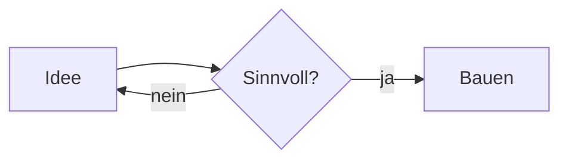

# blog.ecke.lt

Persönlicher Blog von Nils Eckelt — gebaut mit [Astro](https://astro.build),
gehostet als **Cloudflare Worker** mit Static Assets. Teilt sich die Designsprache mit
[nils.ecke.lt](https://nils.ecke.lt) (Profil) und
[book.ecke.lt](https://book.ecke.lt) (Buchung).

## Entwicklung

```bash
npm install
npm run dev      # http://localhost:4321
npm run build    # statischer Output nach ./dist
npm run preview  # gebauten Output lokal ansehen
```

Node 22 (siehe `.nvmrc`).

## Einen Beitrag schreiben

Neue Markdown-Datei unter `src/content/blog/` anlegen, z. B.
`src/content/blog/2026-07-15-mein-thema.md`:

```markdown
---
title: "Titel des Beitrags"
description: "Ein bis zwei Sätze für Übersicht, OG-Tags und RSS."
pubDate: 2026-07-15
# updatedDate: 2026-07-20   # optional
tags: ["Cloud", "Agentic"]   # optional
draft: false                 # true = wird nicht veröffentlicht
---

Inhalt als Markdown …
```

Der Dateiname (ohne `.md`) wird zur URL: `/blog/2026-07-15-mein-thema/`.
Übersicht, Beitragsseite, Sitemap und RSS-Feed (`/rss.xml`) entstehen
automatisch.

### Mermaid-Diagramme

Ein Code-Block mit Sprache `mermaid` wird automatisch als Diagramm gerendert:

````markdown

````

Das Rendering passiert **client-seitig** und liest die Design-Tokens live aus —
Diagramme nutzen also dieselben Farben/Schriften wie die Seite und schalten
automatisch zwischen Light/Dark um. Gerendert wird mit `v1/mermaid.js` des
Design-Systems (`https://ecke-design-system.pages.dev/v1/mermaid.js`); es wird
nur auf Beiträgen geladen, die tatsächlich ein Diagramm enthalten. Die
Akzentfarbe kommt vom ersten Tag des Beitrags (`--diagram-accent` an `<html>`,
siehe `src/styles/global.css`).

## Deployment (Cloudflare Worker mit Static Assets)

Ausgeliefert wird `blog.ecke.lt` von einem Cloudflare **Worker** namens `blog`,
der das Build-Verzeichnis `./dist` als Static Assets ausliefert
(`wrangler.jsonc`). Es gibt kein Pages-Projekt, keine Git-Integration und
kein CI: Ein `git push` deployt **nicht**.

Deploy von Hand:

```sh
npm run build
npx wrangler deploy
```

## Design-System

Tokens, Schriften und Basis-Stile kommen aus dem gemeinsamen
ecke.lt Design-System: `BaseHead.astro` bindet
`https://ecke-design-system.pages.dev/v1/styles.css` ein. Der Blog hat keine
eigene Token-Kopie und keine eigenen Fonts mehr; `src/styles/global.css`
enthält nur Blog-Layout und die Stellen, an denen der Blog bewusst von den
Basis-Stilen des Design-Systems abweicht.

## Struktur

```
public/
  favicon-32.png, apple-touch-icon.png, ne.svg
src/
  styles/
    global.css      Blog-Layout + Prose, baut auf dem Design-System (v1/styles.css)
  components/        BaseHead, Header, Footer, FormattedDate
  layouts/           BaseLayout, PostLayout
  content/blog/      die Beiträge (Markdown)
  pages/             index (Übersicht), blog/[...slug], rss.xml
  content.config.ts  Schema der Blog-Collection
  consts.ts          Site-Metadaten + Navigation
```
